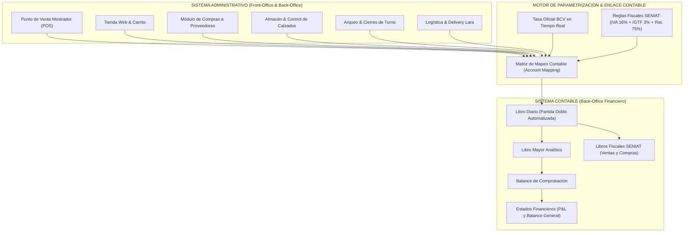
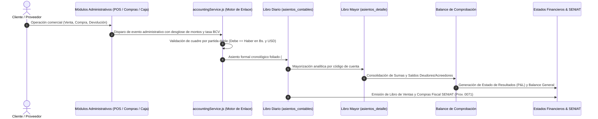

# INFORME TÉCNICO-ACADÉMICO: SISTEMA ADMINISTRATIVO CONTABLE
## Caso de Estudio Aplicado: UrbanStep Venezuela C.A. (ERP Comercial Multimoneda)
**Materia:** Sistemas Administrativos Contables  
**Entidad Evaluada:** UrbanStep Venezuela C.A. • RIF: J-50123456-7  
**Sede Operativa:** Barquisimeto, Estado Lara, Venezuela  
**Marco Normativo:** Normas de Información Financiera de Venezuela (VEN-NIIF PYME), Código de Comercio Venezolano, Providencias Administrativas SENIAT (SNAT/2011/0071, SNAT/2022/000013 / Prov. 0038/0056 IGTF).  
**Arquitectura Tecnológica:** React 19 + Vite + Node.js + PostgreSQL / Supabase + Motor Offline IndexedDB.

---



---

## 1. Definición, Importancia, Objetivos y Beneficios

### 1.1 Definición de Sistema Administrativo Contable
Un **Sistema Administrativo Contable** es una estructura tecnológica y procedimental integrada que captura, procesa, valida, almacena y comunica información cuantitativa y cualitativa sobre los hechos económicos y operativos de una organización. 

En **UrbanStep Venezuela C.A.**, este sistema actúa como el núcleo neurálgico del negocio: articula la gestión operativa diaria (venta de calzados y calzado deportivo, facturación en mostrador, recepción de lotes de mercancía, control de existencias por talla/color y despachos en Barquisimeto) con el registro formal de partida doble bajo principios de contabilidad generalmente aceptados (**VEN-NIIF**) y el cumplimiento tributario obligatorio (**SENIAT**).

### 1.2 Importancia en el Contexto Venezolano
En una economía con circulación bimoneda (*Dólar estadounidense USD* y *Bolívar venezolano VES*), fluctuaciones cambiarias diarias e imposición fiscal rigurosa (IGTF del 3% en divisas y retenciones de IVA del 75%/100%), operar sin un sistema integrado genera:
1. **Descuadres fiscales severos** entre el Libro de Ventas y las declaraciones de IVA e IGTF.
2. **Pérdida de valor del inventario** por falta de costeo promedio ponderado en divisas.
3. **Fugas de caja** en turnos con cobros mixtos (efectivo USD, Pago Móvil, tarjetas de débito Biopago y Zelle).

El sistema de UrbanStep centraliza la tasa del Banco Central de Venezuela (**BCV**) y sincroniza cada transacción en ambas monedas simultáneamente, garantizando certeza contable y fiscal.

### 1.3 Objetivos del Sistema en UrbanStep
* **Objetivo General:** Automatizar el flujo transaccional administrativo-financiero para garantizar información contable confiable, oportuna y fiscalmente auditable en tiempo real.
* **Objetivos Específicos:**
  1. Registrar cada venta, devolución o compra con imputación automática de asientos de partida doble (Debe = Haber).
  2. Emitir libros fiscales obligatorios (Libro de Ventas y Compras SENIAT) conforme a la Providencia Administrativa 0071.
  3. Controlar la liquidez multi-instrumento (Cajas físicas USD/VES, bancos nacionales Banesco/BDV y billeteras digitales).
  4. Mantener la valorización exacta de inventarios de sneakers mediante el método de costo promedio ponderado.
  5. Asegurar la continuidad operativa mediante capacidades *offline-first* ante caídas de conectividad eléctrica o de internet.

### 1.4 Beneficios Tangibles Identificados en el Proyecto
* **Eliminación del reproceso contable:** Cero digitación manual de comprobantes; los asientos nacen en el momento en que el cajero cierra el ticket o el encargado recibe una orden de compra.
* **Cumplimiento fiscal sin multas:** Cálculo automatizado de base imponible, alícuota general de IVA (16%), percepción de IGTF (3%) y emisión de comprobantes de retención.
* **Visibilidad gerencial en tiempo real:** Paneles de control (Dashboards) que reflejan el Estado de Resultados, rentabilidad por marca (*Nike, Vans, Adidas, Puma, RS21*) y punto de equilibrio (*Break-Even*).
* **Control estricto de arqueo de caja:** Reducción a cero de descuadres en turnos de cajeros mediante auditoría ciega de billetes y referencias bancarias.

---

## 2. Elementos a Considerar en la Elección de un Sistema Administrativo Contable

Al seleccionar o diseñar la solución para UrbanStep Venezuela C.A., se evaluaron los siguientes criterios estratégicos:

| Criterio | Requerimiento en Venezuela | Solución Implementada en UrbanStep |
| :--- | :--- | :--- |
| **Adaptabilidad Tributaria SENIAT** | Facturación legal, número de control fiscal, IVA 16%, IGTF 3%, retenciones 75%/100%. | Módulo fiscal nativo con validación de RIF (V, E, J, G), correlativos únicos y exportación de Libros de Compras/Ventas. |
| **Manejo Dual de Monedas** | Exigencia de llevar contabilidad formal en Bolívares (VES) pero con precios de referencia y cobros en Dólares (USD). | Motor `useCurrency()` y `bcvService.js` con actualización en tiempo real de la tasa oficial BCV y presentación dual (`$ ⇄ Bs.`). |
| **Resiliencia Operativa (Offline First)** | Cortes de energía eléctrica y fluctuaciones de internet recurrentes en la región centro-occidental. | Base local en IndexedDB con sincronización bidireccional automática hacia PostgreSQL/Supabase una vez restablecida la red. |
| **Seguridad y Control de Acceso (RBAC)** | Segregación de funciones entre cajero, encargado de almacén, contador y administrador. | Control de roles (Admin, Cajero, Almacén) con PIN de supervisor para anulación de facturas, descuentos y devoluciones. |
| **Integración Total Front-Back** | Evitar silos donde el POS no se comunica con el inventario ni con la contabilidad. | Arquitectura monorepo reactiva: una venta descuenta inventario por variante (talla/color) y asienta en el Libro Diario en el mismo ciclo. |
| **Costo Total de Propiedad (TCO)** | Altos costos de licencias en dólares de ERPs tradicionales extranjeros (SAP, Oracle) o locales rígidos (Saint, Profit). | Desarrollo sobre estándares abiertos web modernos, sin pago recurrente por puesto de trabajo, de fácil mantenimiento y despliegue rápido. |

---

## 3. Ciclo Contable en UrbanStep

El ciclo contable en UrbanStep sigue una secuencia cronológica y metodológica rigurosa basada en VEN-NIIF, desde el origen de la transacción comercial hasta el cierre de cuentas:



### Fases del Ciclo Contable en el Código del Proyecto:
1. **Captura del Hecho Económico:**
   - Ocurre en `saleServices.js` (Ventas), `purchaseService.js` (Compras), `returnService.js` (Notas de Crédito) o `shiftService.js` (Cierre Z de turno).
   - El documento registra: Fecha, RIF/Cédula, número de factura, número de control, subtotal neto, alícuota IVA 16%, percepción IGTF 3% y tasa oficial BCV.
2. **Generación Automatizada del Asiento en el Libro Diario (`getLibroDiario`):**
   - El servicio `accountingService.js` convierte la transacción en un asiento contable formal estructurado en cabecera y renglones.
   - Aplica el principio de **dualidad económica**: el débito en cuentas de activo (Caja, Banco) o costo es exactamente igual al crédito en cuentas de ingreso, pasivo fiscal o inventario.
3. **Mayorización Analítica (`computeLibroMayor`):**
   - Agrupa todos los débitos y créditos por cada cuenta del catálogo de cuentas (`DEFAULT_PLAN_CUENTAS`).
   - Determina el saldo final según la naturaleza de la cuenta:
     $$\text{Saldo Deudor} = \text{Total Debe} - \text{Total Haber} \quad (\text{para Activos, Costos y Gastos})$$
     $$\text{Saldo Acreedor} = \text{Total Haber} - \text{Total Debe} \quad (\text{para Pasivos, Patrimonio e Ingresos})$$
4. **Balance de Comprobación de Sumas y Saldos (`computeBalanceComprobacion`):**
   - Verifica la igualdad matemática de partida doble:
     $$\sum \text{Debe} = \sum \text{Haber} \quad \land \quad \sum \text{Saldos Deudores} = \sum \text{Saldos Acreedores}$$
   - Si la diferencia es mayor a cero céntimos, emite alerta de descuadre contable.
5. **Ajustes y Cierre de Período (`migrar_ventas_a_contabilidad` / Asiento de Cierre):**
   - Al finalizar el mes, las cuentas de resultado (Clase 4 Ingresos, Clase 5 Costos, Clase 6 Gastos) se cancelan contra la cuenta patrimonial `3.3.01.01.001` (*Utilidad Neta del Ejercicio Actual*).
6. **Emisión de Estados Financieros (`computeEstadosFinancieros`):**
   - **Estado de Resultados:** Refleja la rentabilidad económica: Ingresos - Costo de Ventas = Utilidad Bruta - Gastos Operativos = Utilidad Neta.
   - **Balance General:** Refleja la posición financiera bajo la ecuación fundamental de la contabilidad:
     $$\text{Activo} = \text{Pasivo} + \text{Patrimonio}$$

---

## 4. Sistema Administrativo – Módulos de UrbanStep

El sistema administrativo de UrbanStep comprende los módulos de soporte operativo directo al negocio:

```
┌────────────────────────────────────────────────────────────────────────┐
│                   MÓDULOS ADMINISTRATIVOS URBANSTEP                    │
├───────────────┬────────────────┬───────────────────┬───────────────────┤
│ 1. Ventas/POS │ 2. Compras     │ 3. Inventario     │ 4. Clientes/CRM   │
│ - Mostrador   │ - Proveedores  │ - Sneakers/Tallas │ - Cédula / RIF    │
│ - Tienda Web  │ - Facturas Prov│ - Kardex Físico   │ - Crédito/Historial│
│ - Cobro Mixto │ - Retenc. 75%  │ - Stock Crítico   │ - Fidelización    │
├───────────────┼────────────────┼───────────────────┼───────────────────┤
│ 5. Tesorería  │ 6. Delivery    │ 7. Configuración  │ 8. Seguridad/RBAC │
│ - Cierres Z   │ - Flota Envíos │ - Tasa BCV Oficial│ - Roles & Permisos│
│ - Banesco/BDV │ - Tarifas Lara │ - Datos SENIAT    │ - PIN Supervisor  │
│ - Zelle/USD   │ - Comprobantes │ - Impresora POS   │ - Auditoría Log   │
└───────────────┴────────────────┴───────────────────┴───────────────────┘
```

1. **Módulo de Punto de Venta Mostrador (POS) & Tienda Web (`POS.jsx`, `Landing.jsx`):**
   - Registro ágil de ventas mediante lector de código de barras o búsqueda rápida de calzados.
   - Facturación con cobro multidivisa: combinación en un mismo ticket de Dólares en efectivo, Pago Móvil Banesco/BDV, Punto de Venta y Zelle.
   - Cálculo automático en pantalla de vueltos exactos en Bolívares o Dólares.
   - Emisión de comprobantes fiscales térmicos vía protocolo ESC/POS (`escposPrinter.js`).
2. **Módulo de Compras y Cuentas por Pagar (`Purchases.jsx`, `purchaseService.js`):**
   - Emisión y recepción de órdenes de compra a distribuidores mayoristas de calzado deportivo.
   - Registro de facturas de compra con número de control y RIF del proveedor.
   - Deducción del crédito fiscal IVA y cálculo automático de retenciones de IVA (75%) para proveedores calificados como Contribuyentes Especiales.
3. **Módulo de Inventario y Almacén (`Inventory.jsx`, `Warehouse.jsx`, `productService.js`):**
   - Catálogo clasificado por marcas (*Nike, Adidas, Puma, Vans, RS21*), modelos, colores y tallas (36 a 45).
   - Control de existencias en almacén central y mostrador con alertas automáticas de reposición (Stock Crítico menor a 3 unidades).
   - Trazabilidad de entradas, salidas, transferencias y mermas.
4. **Módulo de Gestión de Clientes y Cuentas por Cobrar (`Customers.jsx`, `CustomerSelector.jsx`):**
   - Directorio de clientes con validación estricta de Cédula o RIF venezolano.
   - Historial de compras, tickets emitidos y saldo de cuentas corrientes.
5. **Módulo de Caja y Control de Turnos (`CashierTerminal.jsx`, `shiftService.js`):**
   - Apertura de turno con fondo inicial de caja en USD y VES.
   - Proceso de **Arqueo Ciego**: el cajero cuenta físicamente el dinero en efectivo y el sistema calcula automáticamente los sobrantes o faltantes contra las ventas registradas.
   - Generación del **Corte Z** fiscal al cierre del turno.
6. **Módulo de Logística y Despacho Delivery (`Delivery.jsx`, `deliveryService.js`):**
   - Asignación de carreras y pedidos web a la flota de motorizados en Barquisimeto y Cabudare.
   - Control de comisiones por flete y liquidación periódica a repartidores con recibos foliados.
7. **Módulo de Configuración y Parámetros del Negocio (`Settings.jsx`, `settingsService.js`):**
   - Parámetros fiscales: RIF de la empresa (`J-50123456-7`), dirección fiscal, porcentaje de IVA (16%), alícuota IGTF (3%).
   - Monitoreo del servicio automatizado de tasa BCV (`bcvService.js`).

---

## 5. Plan de Cuentas Contable – Estructura VEN-NIIF en UrbanStep

El Plan de Cuentas del sistema fue codificado bajo una estructura jerárquica decimal de **5 niveles**, respetando las Normas Internacionales de Información Financiera aplicables a Venezuela:

```
Nivel 1: CLASE               Ej: 1          ACTIVO
Nivel 2: GRUPO               Ej: 1.1        ACTIVO CORRIENTE
Nivel 3: RUBRO               Ej: 1.1.01     Efectivo y Equivalentes de Efectivo
Nivel 4: CUENTA DE MAYOR     Ej: 1.1.01.01  Caja General
Nivel 5: SUBCUENTA/AUXILIAR  Ej: 1.1.01.01.001 Caja Principal Mostrador (VES) -> Acepta Movimiento
```

### Catálogo de Cuentas Maestro del Sistema (`DEFAULT_PLAN_CUENTAS`):

```
1 ACTIVO (Deudora)
├── 1.1 ACTIVO CORRIENTE
│   ├── 1.1.01 Efectivo y Equivalentes de Efectivo
│   │   ├── 1.1.01.01 Caja General
│   │   │   ├── 1.1.01.01.001 Caja Principal Mostrador (VES) [AUX]
│   │   │   └── 1.1.01.01.002 Caja Moneda Extranjera (USD) [AUX]
│   │   ├── 1.1.01.02 Bancos Nacionales (VES)
│   │   │   ├── 1.1.01.02.001 Banesco Banco Universal (Pago Móvil / Transf.) [AUX]
│   │   │   └── 1.1.01.02.002 Banco de Venezuela (Biopago / Puntos) [AUX]
│   │   └── 1.1.01.03 Cuentas en Divisas y Billeteras Digitales
│   │       ├── 1.1.01.03.001 Zelle / Custodia Divisas [AUX]
│   │       └── 1.1.01.03.002 Zinli / Wally Tech [AUX]
│   ├── 1.1.02 Cuentas y Documentos por Cobrar
│   │   └── 1.1.02.01.001 Cuentas por Cobrar Clientes Mostrador / Delivery [AUX]
│   ├── 1.1.03 Inventarios
│   │   ├── 1.1.03.01.001 Inventario de Calzado Deportivo (Sneakers) [AUX]
│   │   └── 1.1.03.01.002 Inventario de Streetwear y Accesorios [AUX]
│   └── 1.1.04 Créditos Fiscales y Pagos Anticipados
│       ├── 1.1.04.01.001 Crédito Fiscal IVA 16% (Compras) [AUX]
│       └── 1.1.04.02.001 Retenciones de IVA Soportadas (Clientes Especiales) [AUX]

2 PASIVO (Acreedora)
└── 2.1 PASIVO CORRIENTE
    ├── 2.1.01 Cuentas por Pagar Comerciales
    │   └── 2.1.01.01.001 Proveedores Nacionales de Calzado [AUX]
    └── 2.1.02 Tributos y Contribuciones por Pagar
        ├── 2.1.02.01.001 Débito Fiscal IVA 16% (Ventas) [AUX]
        ├── 2.1.02.02.001 IGTF 3% Percibido en Divisas por Pagar [AUX]
        ├── 2.1.02.03.001 Retenciones de IVA por Enterar al SENIAT (75%/100%) [AUX]
        └── 2.1.02.04.001 Retenciones de ISLR por Enterar [AUX]

3 PATRIMONIO (Acreedora)
├── 3.1 Capital Social
│   └── 3.1.01.01.001 Capital Suscrito y Pagado [AUX]
└── 3.3 Resultados Acumulados
    ├── 3.3.01.01.001 Utilidad Neta del Ejercicio Actual [AUX]
    └── 3.3.02.01.001 Utilidades Retenidas de Ejercicios Anteriores [AUX]

4 INGRESOS (Acreedora)
├── 4.1 Ingresos Operacionales
│   ├── 4.1.01.01.001 Ventas de Calzado Mostrador POS [AUX]
│   ├── 4.1.01.01.002 Ventas de Calzado Canal Tienda Online [AUX]
│   └── 4.1.01.02.001 Ingresos por Servicio de Delivery [AUX]
└── 4.2 Ingresos Financieros
    └── 4.2.01.01.001 Ganancia Cambiaria (Diferencial Tasa BCV) [AUX]

5 COSTO DE VENTAS (Deudora)
└── 5.1 Costos Operacionales
    └── 5.1.01.01.001 Costo de Ventas - Calzado Deportivo [AUX]

6 GASTOS OPERACIONALES Y ADMINISTRATIVOS (Deudora)
├── 6.1 Gastos Generales
│   ├── 6.1.01.01.001 Gastos de Fletes y Despachos Delivery Lara [AUX]
│   ├── 6.1.02.01.001 Comisiones Bancarias y Costos Puntos de Venta [AUX]
│   └── 6.1.03.01.001 Mermas y Ajustes de Inventario [AUX]
└── 6.2 Gastos Financieros
    └── 6.2.01.01.001 Pérdida Cambiaria [AUX]
```

> **Regla de Operación:** Solo las cuentas de **Nivel 5** (`acepta_movimiento = true`) admiten imputación de débitos y créditos en los asientos contables. Las cuentas de nivel 1 al 4 son cuentas de acumulación y presentación para el Balance General y el Estado de Resultados.

---

## 6. Sistema Contable – Módulos de UrbanStep

La suite contable formal se agrupa dentro de `Reports.jsx` y `ReportsFinance.jsx`, alimentada por el servicio `accountingService.js`:

1. **Módulo de Catálogo y Plan de Cuentas (`getPlanCuentas`):**
   - Visualización y parametrización del árbol jerárquico de cuentas bajo normativa VEN-NIIF.
   - Asignación de naturaleza (Deudora / Acreedora) y moneda base.
2. **Módulo de Libro Diario Formal (`getLibroDiario`):**
   - Registro cronológico inmutable de todos los asientos generados por ventas, compras, costo de mercancía, mermas y notas de crédito.
   - Verificación de cuadre instantáneo: no se asienta ninguna transacción si $\sum \text{Debe} \neq \sum \text{Haber}$.
   - Soporte bimoneda: cada renglón registra débitos y créditos en Bolívares (VES) y Dólares (USD) a la tasa oficial del día.
3. **Módulo de Libro Mayor Analítico (`computeLibroMayor`):**
   - Clasificación sistemática de débitos y créditos por cada cuenta auxiliar del plan.
   - Cálculo automático del saldo final deudor o acreedor para cada cuenta activa del ejercicio.
4. **Módulo de Balance de Comprobación de Sumas y Saldos (`computeBalanceComprobacion`):**
   - Matriz de control financiero previo a la emisión de estados financieros.
   - Cuadre de 4 columnas: Sumas del Debe / Haber y Saldos Deudores / Acreedores.
5. **Módulo de Estados Financieros Formales (`computeEstadosFinancieros`):**
   - **Estado de Resultados (P&L):** Desglose de ingresos operacionales, costo de ventas por calzados, margen bruto, gastos de operación (fletes, comisiones bancarias) y resultado del ejercicio.
   - **Balance General:** Estructura clasificada de Activo Corriente, Pasivo Corriente y Patrimonio Neto con cuadre automático de la ecuación contable fundamental.
6. **Módulo Fiscal SENIAT (Capa 2):**
   - **Libro de Ventas Fiscal:** Formato oficial reglamentario bajo Providencia SNAT/2011/0071 con número de comprobante, factura, control, base imponible gravable (16%), débito fiscal e IGTF (3%).
   - **Libro de Compras Fiscal:** Registro de compras con crédito fiscal deducible y porcentaje de retención aplicado a proveedores.
   - **Liquidación Tributaria de IVA:** Débitos fiscales menos créditos fiscales del período para determinar la cuota tributaria a pagar al Fisco Nacional.
7. **Módulo de Auditoría y Trazabilidad (`auditService.js`):**
   - Bitácora inmutable con usuario, rol, fecha/hora exacta, IP y valores anteriores/nuevos ante cualquier alteración de registros en el sistema.

---

## 7. Parametrización (Integración) Administrativa - Contable

La **parametrización contable** es el conjunto de reglas automáticas de mapeo (*Account Mapping Rules*) que traducen cada evento del mundo administrativo en un registro contable de partida doble sin requerir intervención humana.

### 7.1 Matriz de Mapeo de Eventos Administrativos a Cuentas Contables

| Evento Administrativo | Condición / Método | Cuenta Débito (DEBE) | Cuenta Crédito (HABER) |
| :--- | :--- | :--- | :--- |
| **Venta en Mostrador (Cobro Efectivo USD)** | Pago recibido en dólares físicos | `1.1.01.01.002` Caja Moneda Extranjera | `4.1.01.01.001` Ventas Mostrador POS<br>`2.1.02.01.001` Débito Fiscal IVA 16%<br>`2.1.02.02.001` IGTF 3% Divisas por Pagar |
| **Venta en Mostrador (Pago Móvil / Punto)** | Pago en Bolívares bancarios | `1.1.01.02.001` Banesco Banco Universal o<br>`1.1.01.02.002` Banco de Venezuela | `4.1.01.01.001` Ventas Mostrador POS<br>`2.1.02.01.001` Débito Fiscal IVA 16% |
| **Costo de Ventas (Automático en cada venta)** | Entrega de calzado al cliente | `5.1.01.01.001` Costo de Ventas - Calzado | `1.1.03.01.001` Inventario de Sneakers |
| **Factura de Compra a Proveedor** | Recepción de lote con retención 75% | `1.1.03.01.001` Inventario de Calzado<br>`1.1.04.01.001` Crédito Fiscal IVA 16% | `2.1.02.03.001` Retención IVA por Enterar (75%)<br>`2.1.01.01.001` Cuentas x Pagar Proveedores |
| **Devolución / Nota de Crédito** | Cliente devuelve calzado por garantía | `4.1.01.01.001` Ventas (Reversión)<br>`2.1.02.01.001` Débito IVA (Ajuste) | `1.1.01.01.002` Caja USD / `1.1.01.02.001` Banesco (Reembolso) |
| **Despacho Delivery Facturado** | Cliente paga tarifa de envío | `1.1.01.01.001` Caja Mostrador / Bancos | `4.1.01.02.001` Ingresos por Servicio Delivery |
| **Faltante de Caja en Arqueo** | Conteo físico menor al esperado | `6.1.03.01.001` Gastos por Descuadres de Caja | `1.1.01.01.001` Caja Principal Mostrador |

---

### 7.2 Casos Prácticos Reales de Partida Doble en UrbanStep

A continuación se presentan los tres modelos de asientos contables que ejecuta automáticamente el motor de UrbanStep, con cifras reales y cuadre formal en ambas monedas:

#### Caso A: Venta Mixta de Calzado Mostrador con IGTF 3% (Tasa BCV: 876.80 Bs/USD)
* **Hecho Comercial:** Venta de 1 par *Nike Air Jordan 1 Retro* por valor de `$120.00` (Subtotal `$103.45` + IVA 16% `$16.55`).
* **Modalidad de Cobro Mixta:**
  - `$80.00` en efectivo USD $\rightarrow$ aplica percepción de IGTF del 3% = `$2.40` $\rightarrow$ Total cobrado en USD: `$82.40`.
  - Saldo de `$40.00` pagado en Bolívares vía Pago Móvil Banesco a Tasa BCV = $\text{Bs. } 35,072.00$.
* **Costo de Mercancía Asociado:** Costo promedio de compra del par: `$62.00` ($\text{Bs. } 54,361.60$).

**Asiento N° 10050: Factura de Venta POS**
```
-----------------------------------------------------------------------------------------------------------------
Código Cuenta       Nombre de Cuenta                  Debe (Bs.)      Haber (Bs.)      Debe ($)      Haber ($)
-----------------------------------------------------------------------------------------------------------------
1.1.01.01.002       Caja Moneda Extranjera (USD)       72,248.32             0.00         82.40           0.00
1.1.01.02.001       Banesco Pago Móvil (VES)           35,072.00             0.00         40.00           0.00
4.1.01.01.001       Ventas de Calzado Mostrador POS         0.00        90,704.96          0.00         103.45
2.1.02.01.001       Débito Fiscal IVA 16%                   0.00        14,511.04          0.00          16.55
2.1.02.02.001       IGTF 3% Percibido por Pagar (USD)       0.00         2,104.32          0.00           2.40
-----------------------------------------------------------------------------------------------------------------
TOTALES CUADRADOS (Partida Doble):                    107,320.32       107,320.32        122.40         122.40
-----------------------------------------------------------------------------------------------------------------
```

**Asiento N° 10051: Costo de Ventas y Descarga de Almacén (Simultáneo)**
```
-----------------------------------------------------------------------------------------------------------------
Código Cuenta       Nombre de Cuenta                  Debe (Bs.)      Haber (Bs.)      Debe ($)      Haber ($)
-----------------------------------------------------------------------------------------------------------------
5.1.01.01.001       Costo de Ventas - Calzado          54,361.60             0.00         62.00           0.00
1.1.03.01.001       Inventario de Calzado Deportivo         0.00        54,361.60          0.00          62.00
-----------------------------------------------------------------------------------------------------------------
TOTALES CUADRADOS:                                     54,361.60        54,361.60         62.00          62.00
-----------------------------------------------------------------------------------------------------------------
```

---

#### Caso B: Compra de Mercancía con Crédito Fiscal y Retención de IVA 75%
* **Hecho Comercial:** Recepción de factura de compra a *Calzados Los Andes C.A.* (RIF: J-30456789-0) por 100 pares de sneakers por `$5,000.00` + IVA 16% `$800.00` = Total `$5,800.00`.
* **Retención SENIAT:** Como Contribuyente Especial, UrbanStep retiene el 75% del IVA facturado:
  $$\text{Retención IVA} = \$800.00 \times 75\% = \$600.00 \quad (\text{Bs. } 526,080.00)$$
* **Neto por Pagar al Proveedor:**
  $$\text{Saldo Neto} = \$5,800.00 - \$600.00 = \$5,200.00 \quad (\text{Bs. } 4,559,360.00)$$

**Asiento N° 10052: Registro de Compra a Proveedor**
```
-----------------------------------------------------------------------------------------------------------------
Código Cuenta       Nombre de Cuenta                  Debe (Bs.)      Haber (Bs.)      Debe ($)      Haber ($)
-----------------------------------------------------------------------------------------------------------------
1.1.03.01.001       Inventario de Calzado Deportivo 4,384,000.00             0.00      5,000.00           0.00
1.1.04.01.001       Crédito Fiscal IVA 16% (Compras)  701,440.00             0.00        800.00           0.00
2.1.02.03.001       Retenciones IVA por Enterar             0.00       526,080.00          0.00         600.00
2.1.01.01.001       Proveedores Nacionales de Calzado       0.00     4,559,360.00          0.00       5,200.00
-----------------------------------------------------------------------------------------------------------------
TOTALES CUADRADOS (Partida Doble):                  5,085,440.00     5,085,440.00      5,800.00       5,800.00
-----------------------------------------------------------------------------------------------------------------
```

---

## 8. Guía Resumen para la Defensa Grupal

Para obtener la máxima calificación en la exposición y defensa grupal, cada integrante del equipo puede asumir la defensa de los siguientes roles clave:

1. **Expositor 1 (Fundamentos y Criterios de Selección):**
   - Defiende los **Puntos 1 y 2**. Explica por qué un negocio de retail en Venezuela necesita un sistema dual con sincronización BCV y arquitectura *offline*, contrastándolo con los sistemas tradicionales obsoletos.
2. **Expositor 2 (Ciclo Contable y Módulos Administrativos):**
   - Defiende los **Puntos 3 y 4**. Muestra el diagrama de flujo secuencial: cómo la venta en el POS mostrador viaja por el ciclo contable sin digitar nada a mano y describe las funciones de cada pantalla administrativa (POS, Almacén, Compras, Cajas, Delivery).
3. **Expositor 3 (Plan de Cuentas y Módulos Contables):**
   - Defiende los **Puntos 5 y 6**. Expone la jerarquía VEN-NIIF de 5 niveles, la regla de imputación única en Nivel 5 y explica el funcionamiento de los libros contables (Diario, Mayor, Balance de Comprobación y Estados Financieros).
4. **Expositor 4 (Parametrización e Integración Práctica):**
   - Defiende el **Punto 7**. Desarrolla en la pizarra o diapositiva los casos prácticos de partida doble (Venta mixta con IGTF 3% y compra con retención de IVA 75%), demostrando que el sistema cuadra al céntimo en Bolívares y en Dólares.
