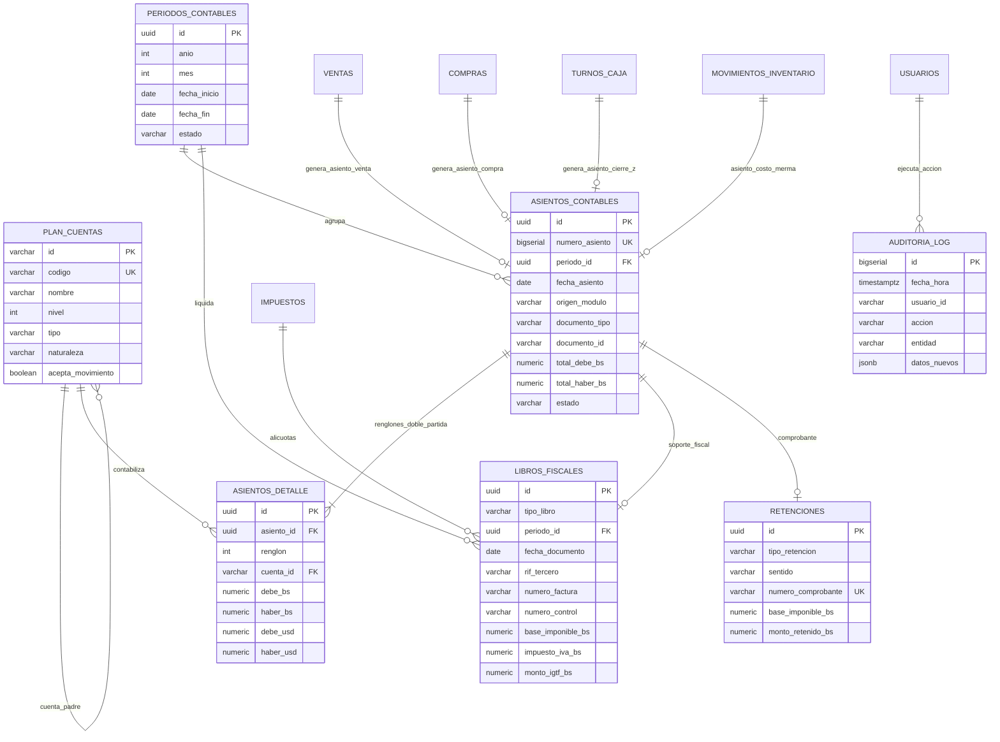

# Sistema de Gestión Fiscal y Financiera SGF — Arquitectura Contable y Rediseño de Reportes
**UrbanStep Venezuela C.A. • RIF: J-50123456-7**  
**Sede Única: Barquisimeto, Estado Lara • Monobase / Monosede**  
**Autores:** Senior Google Fellow (SGF) + Contador Público Colegiado (CPC Venezuela) + Tech Lead ERP  
**Fecha:** Octubre 2026 • Normativa: VEN-NIIF / Providencias SENIAT (SNAT/2011/0071, 0038/0056 IGTF)

---

## 1. Modelo de Datos Completo (PostgreSQL 15+ / Supabase)

### A. Capa 1: Contabilidad Formal y Doble Partida

```sql
-- 1. Plan de Cuentas Contable Configurable (Jerarquía VEN-NIIF)
CREATE TABLE IF NOT EXISTS plan_cuentas (
    id VARCHAR(50) PRIMARY KEY, -- Ej: '1.1.01.01.001'
    codigo VARCHAR(30) UNIQUE NOT NULL,
    nombre VARCHAR(150) NOT NULL,
    nivel INTEGER NOT NULL CHECK (nivel BETWEEN 1 AND 5),
    -- 1: Clase, 2: Grupo, 3: Rubro, 4: Cuenta de Mayor, 5: Subcuenta / Auxiliar
    tipo VARCHAR(20) NOT NULL CHECK (tipo IN ('activo', 'pasivo', 'patrimonio', 'ingreso', 'costo', 'gasto', 'orden')),
    naturaleza VARCHAR(10) NOT NULL CHECK (naturaleza IN ('deudora', 'acreedora')),
    acepta_movimiento BOOLEAN NOT NULL DEFAULT false,
    cuenta_padre_id VARCHAR(50) REFERENCES plan_cuentas(id) ON DELETE RESTRICT,
    moneda VARCHAR(3) NOT NULL DEFAULT 'VES',
    activo BOOLEAN NOT NULL DEFAULT true,
    creado_el TIMESTAMPTZ NOT NULL DEFAULT NOW(),
    actualizado_el TIMESTAMPTZ NOT NULL DEFAULT NOW()
);

CREATE INDEX idx_plan_cuentas_codigo ON plan_cuentas(codigo);
CREATE INDEX idx_plan_cuentas_padre ON plan_cuentas(cuenta_padre_id);
CREATE INDEX idx_plan_cuentas_tipo ON plan_cuentas(tipo);

-- 2. Períodos Contables con Bloqueo de Modificación
CREATE TABLE IF NOT EXISTS periodos_contables (
    id UUID PRIMARY KEY DEFAULT gen_random_uuid(),
    anio INTEGER NOT NULL,
    mes INTEGER NOT NULL CHECK (mes BETWEEN 1 AND 12),
    fecha_inicio DATE NOT NULL,
    fecha_fin DATE NOT NULL,
    estado VARCHAR(20) NOT NULL DEFAULT 'abierto' CHECK (estado IN ('abierto', 'cerrado', 'auditado')),
    cerrado_por VARCHAR(100),
    fecha_cierre TIMESTAMPTZ,
    asiento_cierre_id UUID,
    notas TEXT,
    creado_el TIMESTAMPTZ NOT NULL DEFAULT NOW(),
    CONSTRAINT uq_periodo_mes_anio UNIQUE (anio, mes),
    CONSTRAINT chk_fechas_periodo CHECK (fecha_fin >= fecha_inicio)
);

CREATE INDEX idx_periodos_estado ON periodos_contables(estado);

-- 3. Tipos de Cambio Oficiales e Históricos
CREATE TABLE IF NOT EXISTS tipos_cambio (
    id UUID PRIMARY KEY DEFAULT gen_random_uuid(),
    fecha DATE NOT NULL,
    tasa_bcv NUMERIC(14, 6) NOT NULL CHECK (tasa_bcv > 0),
    tasa_paralelo NUMERIC(14, 6) CHECK (tasa_paralelo > 0),
    fuente VARCHAR(50) NOT NULL DEFAULT 'BCV_OFICIAL',
    creado_por VARCHAR(100) DEFAULT 'SISTEMA',
    creado_el TIMESTAMPTZ NOT NULL DEFAULT NOW(),
    CONSTRAINT uq_tipo_cambio_fecha_fuente UNIQUE (fecha, fuente)
);

CREATE INDEX idx_tipos_cambio_fecha ON tipos_cambio(fecha DESC);

-- 4. Cabecera del Libro Diario (Asientos Contables)
CREATE TABLE IF NOT EXISTS asientos_contables (
    id UUID PRIMARY KEY DEFAULT gen_random_uuid(),
    numero_asiento BIGSERIAL UNIQUE,
    periodo_id UUID NOT NULL REFERENCES periodos_contables(id) ON DELETE RESTRICT,
    fecha_asiento DATE NOT NULL,
    origen_modulo VARCHAR(30) NOT NULL CHECK (origen_modulo IN ('ventas', 'compras', 'tesoreria', 'inventario', 'manual', 'cierre')),
    documento_tipo VARCHAR(40) NOT NULL, -- 'factura_venta', 'factura_compra', 'cierre_z', 'kardex', 'ajuste'
    documento_id VARCHAR(100) NOT NULL,  -- ID en ventas, compras, etc.
    descripcion TEXT NOT NULL,
    tasa_cambio_bcv NUMERIC(14, 6) NOT NULL,
    tasa_cambio_paralelo NUMERIC(14, 6),
    total_debe_bs NUMERIC(16, 2) NOT NULL DEFAULT 0.00,
    total_haber_bs NUMERIC(16, 2) NOT NULL DEFAULT 0.00,
    total_debe_usd NUMERIC(16, 2) NOT NULL DEFAULT 0.00,
    total_haber_usd NUMERIC(16, 2) NOT NULL DEFAULT 0.00,
    estado VARCHAR(20) NOT NULL DEFAULT 'asentado' CHECK (estado IN ('borrador', 'asentado', 'anulado')),
    creado_por VARCHAR(100) NOT NULL,
    creado_el TIMESTAMPTZ NOT NULL DEFAULT NOW(),
    anulado_el TIMESTAMPTZ,
    anulado_por VARCHAR(100),
    motivo_anulacion TEXT,
    CONSTRAINT chk_asiento_cuadre_bs CHECK (total_debe_bs = total_haber_bs),
    CONSTRAINT chk_asiento_cuadre_usd CHECK (total_debe_usd = total_haber_usd)
);

CREATE INDEX idx_asientos_fecha ON asientos_contables(fecha_asiento);
CREATE INDEX idx_asientos_periodo ON asientos_contables(periodo_id);
CREATE INDEX idx_asientos_documento ON asientos_contables(documento_tipo, documento_id);

-- 5. Renglones / Detalle del Asiento (Libro Mayor Analítico)
CREATE TABLE IF NOT EXISTS asientos_detalle (
    id UUID PRIMARY KEY DEFAULT gen_random_uuid(),
    asiento_id UUID NOT NULL REFERENCES asientos_contables(id) ON DELETE CASCADE,
    renglon INTEGER NOT NULL,
    cuenta_id VARCHAR(50) NOT NULL REFERENCES plan_cuentas(id) ON DELETE RESTRICT,
    concepto TEXT,
    debe_bs NUMERIC(16, 2) NOT NULL DEFAULT 0.00 CHECK (debe_bs >= 0),
    haber_bs NUMERIC(16, 2) NOT NULL DEFAULT 0.00 CHECK (haber_bs >= 0),
    debe_usd NUMERIC(16, 2) NOT NULL DEFAULT 0.00 CHECK (debe_usd >= 0),
    haber_usd NUMERIC(16, 2) NOT NULL DEFAULT 0.00 CHECK (haber_usd >= 0),
    referencia_externa VARCHAR(100),
    creado_el TIMESTAMPTZ NOT NULL DEFAULT NOW(),
    CONSTRAINT uq_asiento_renglon UNIQUE (asiento_id, renglon),
    CONSTRAINT chk_exclusividad_debe_haber CHECK (
        (debe_bs > 0 AND haber_bs = 0) OR
        (haber_bs > 0 AND debe_bs = 0)
    )
);

CREATE INDEX idx_asientos_detalle_cuenta ON asientos_detalle(cuenta_id);
CREATE INDEX idx_asientos_detalle_asiento ON asientos_detalle(asiento_id);
```

---

### B. Capa 2: Fiscal Venezuela (SENIAT, IVA, IGTF, Retenciones)

```sql
-- 6. Configuración de Impuestos y Cuentas Vinculadas
CREATE TABLE IF NOT EXISTS impuestos (
    id VARCHAR(30) PRIMARY KEY, -- 'IVA_16', 'IVA_REDUCIDO_8', 'EXENTO', 'IGTF_3'
    descripcion VARCHAR(100) NOT NULL,
    alicuota NUMERIC(5, 2) NOT NULL,
    base_calculo VARCHAR(20) NOT NULL,
    cuenta_contable_debito_id VARCHAR(50) REFERENCES plan_cuentas(id),
    cuenta_contable_credito_id VARCHAR(50) REFERENCES plan_cuentas(id),
    activo BOOLEAN NOT NULL DEFAULT true
);

-- 7. Libros Fiscales Oficiales (Compras y Ventas SENIAT)
CREATE TABLE IF NOT EXISTS libros_fiscales (
    id UUID PRIMARY KEY DEFAULT gen_random_uuid(),
    tipo_libro VARCHAR(10) NOT NULL CHECK (tipo_libro IN ('ventas', 'compras')),
    periodo_id UUID NOT NULL REFERENCES periodos_contables(id),
    numero_operacion BIGSERIAL,
    fecha_documento DATE NOT NULL,
    rif_tercero VARCHAR(20) NOT NULL,
    razon_social_tercero VARCHAR(200) NOT NULL,
    numero_factura VARCHAR(50) NOT NULL,
    numero_control VARCHAR(50) NOT NULL,
    numero_nota_debito VARCHAR(50),
    numero_nota_credito VARCHAR(50),
    tipo_transaccion VARCHAR(10) NOT NULL DEFAULT '01-REG',
    factura_afectada VARCHAR(50),
    total_con_iva_bs NUMERIC(16, 2) NOT NULL,
    monto_exento_bs NUMERIC(16, 2) NOT NULL DEFAULT 0.00,
    base_imponible_bs NUMERIC(16, 2) NOT NULL,
    alicuota_iva NUMERIC(5, 2) NOT NULL DEFAULT 16.00,
    impuesto_iva_bs NUMERIC(16, 2) NOT NULL,
    monto_igtf_bs NUMERIC(16, 2) NOT NULL DEFAULT 0.00,
    iva_retenido_bs NUMERIC(16, 2) NOT NULL DEFAULT 0.00,
    comprobante_retencion_iva VARCHAR(50),
    documento_origen_id VARCHAR(100) NOT NULL,
    asiento_id UUID REFERENCES asientos_contables(id),
    creado_el TIMESTAMPTZ NOT NULL DEFAULT NOW()
);

CREATE INDEX idx_libros_fiscales_tipo_periodo ON libros_fiscales(tipo_libro, periodo_id);
CREATE INDEX idx_libros_fiscales_fecha ON libros_fiscales(fecha_documento);

-- 8. Comprobantes de Retención de IVA e ISLR
CREATE TABLE IF NOT EXISTS retenciones (
    id UUID PRIMARY KEY DEFAULT gen_random_uuid(),
    tipo_retencion VARCHAR(10) NOT NULL CHECK (tipo_retencion IN ('IVA', 'ISLR')),
    sentido VARCHAR(10) NOT NULL CHECK (sentido IN ('recibida', 'emitida')), 
    -- 'emitida' = retención aplicada a proveedores; 'recibida' = retenida por clientes especiales
    numero_comprobante VARCHAR(30) UNIQUE NOT NULL, -- AAAAMMNROCOMPROBANTE
    periodo_fiscal VARCHAR(7) NOT NULL, -- '2026-10'
    fecha_comprobante DATE NOT NULL,
    sujeto_retenido_rif VARCHAR(20) NOT NULL,
    sujeto_retenido_nombre VARCHAR(200) NOT NULL,
    numero_factura VARCHAR(50) NOT NULL,
    numero_control VARCHAR(50) NOT NULL,
    base_imponible_bs NUMERIC(16, 2) NOT NULL,
    porcentaje_retencion NUMERIC(5, 2) NOT NULL, -- 75% / 100% (IVA) ó 1% / 2% (ISLR)
    monto_retenido_bs NUMERIC(16, 2) NOT NULL,
    asiento_id UUID REFERENCES asientos_contables(id),
    declarado_seniat BOOLEAN NOT NULL DEFAULT false,
    creado_el TIMESTAMPTZ NOT NULL DEFAULT NOW()
);

CREATE INDEX idx_retenciones_periodo ON retenciones(periodo_fiscal);
CREATE INDEX idx_retenciones_tipo ON retenciones(tipo_retencion, sentido);
```

---

### C. Capa 6: Auditoría del Sistema (Log Inmutable)

```sql
-- 9. Log de Auditoría Inmutable del Sistema
CREATE TABLE IF NOT EXISTS auditoria_log (
    id BIGSERIAL PRIMARY KEY,
    fecha_hora TIMESTAMPTZ NOT NULL DEFAULT NOW(),
    usuario_id VARCHAR(100) NOT NULL,
    usuario_nombre VARCHAR(150) NOT NULL,
    usuario_rol VARCHAR(50) NOT NULL,
    modulo VARCHAR(50) NOT NULL,
    accion VARCHAR(50) NOT NULL, -- 'INSERT', 'UPDATE', 'DELETE', 'CIERRE_CONTABLE', 'EXPORT_SENIAT'
    entidad VARCHAR(50) NOT NULL, -- 'asientos_contables', 'ventas', 'periodos_contables', etc.
    registro_id VARCHAR(100) NOT NULL,
    ip_address VARCHAR(45),
    datos_anteriores JSONB,
    datos_nuevos JSONB,
    descripcion TEXT NOT NULL
);

CREATE INDEX idx_auditoria_fecha ON auditoria_log(fecha_hora DESC);
CREATE INDEX idx_auditoria_entidad ON auditoria_log(entidad, registro_id);
```

---

## 2. Diagrama Entidad-Relación (Mermaid)



---

## 3. Especificación de API REST (Endpoints por Capa)

### Capa 1: Contabilidad Formal
| Método | Endpoint | Descripción | Parámetros Clave |
| :--- | :--- | :--- | :--- |
| `GET` | `/api/v1/contabilidad/plan-cuentas` | Árbol jerárquico del Plan de Cuentas VEN-NIIF | `?nivel=5&activo=true` |
| `POST` | `/api/v1/contabilidad/plan-cuentas` | Crea o ajusta cuenta auxiliar (Nivel 5) | `{ codigo, nombre, tipo, naturaleza, cuenta_padre_id }` |
| `GET` | `/api/v1/contabilidad/libro-diario` | Libro Diario cronológico de asientos con filtros | `?desde=2026-10-01&hasta=2026-10-31&modulo=ventas` |
| `POST` | `/api/v1/contabilidad/asientos` | Registro manual de asiento (requiere Debe = Haber) | `{ fecha, concepto, renglones: [{ cuenta_id, debe_bs, haber_bs }] }` |
| `GET` | `/api/v1/contabilidad/libro-mayor` | Libro Mayor consolidado o por cuenta analítica | `?cuenta_id=1.1.01.01.001&periodo_id=...` |
| `GET` | `/api/v1/contabilidad/balance-comprobacion` | Balance de Comprobación de Sumas y Saldos | `?periodo_id=...` |
| `GET` | `/api/v1/contabilidad/estados-financieros/balance-general` | Balance General formal clasificado (Activo, Pasivo, Patrimonio) | `?corte_al=2026-10-31&moneda=VES` |
| `GET` | `/api/v1/contabilidad/estados-financieros/estado-resultados` | Estado de Resultados (Ingresos, Costo de Ventas, Gastos Op.) | `?desde=...&hasta=...&moneda=VES` |
| `GET` | `/api/v1/contabilidad/estados-financieros/flujo-efectivo` | Flujo de Efectivo formal (Método Directo e Indirecto) | `?periodo_id=...` |
| `POST` | `/api/v1/contabilidad/periodos/cerrar` | Cierre contable mensual/anual con bloqueo de asientos | `{ anio, mes, asiento_cierre: true }` |

### Capa 2: Fiscal Venezuela (SENIAT)
| Método | Endpoint | Descripción | Parámetros Clave |
| :--- | :--- | :--- | :--- |
| `GET` | `/api/v1/fiscal/libro-ventas` | Libro de Ventas mensual formato Providencia SENIAT 0071 | `?anio=2026&mes=10` |
| `GET` | `/api/v1/fiscal/libro-ventas/exportar` | Exportación oficial en formato TXT / Excel para SENIAT | `?formato=txt_seniat&periodo_id=...` |
| `GET` | `/api/v1/fiscal/libro-compras` | Libro de Compras formal con créditos fiscales y RIF | `?anio=2026&mes=10` |
| `GET` | `/api/v1/fiscal/retenciones/iva` | Relación de Comprobantes de Retención de IVA emitidos/recibidos | `?periodo=2026-10` |
| `GET` | `/api/v1/fiscal/retenciones/iva/exportar-txt` | Genera archivo TXT para declaración quincenal de retenciones | `?quincena=1&periodo=2026-10` |
| `GET` | `/api/v1/fiscal/retenciones/islr` | Relación de retenciones de ISLR (1% bienes, 2% servicios) | `?periodo=2026-10` |
| `GET` | `/api/v1/fiscal/resumen-iva-igtf` | Liquidación fiscal: Débitos vs Créditos IVA 16% + IGTF 3% Divisas | `?anio=2026&mes=10` |

### Capa 3: Tesorería (Caja + Bancos)
| Método | Endpoint | Descripción | Parámetros Clave |
| :--- | :--- | :--- | :--- |
| `GET` | `/api/v1/tesoreria/consolidado` | Posición consolidada de efectivo, bancos nacionales y cuentas USD | N/A |
| `GET` | `/api/v1/tesoreria/conciliacion-bancaria` | Conciliación de cuentas de banco contra estados de cuenta | `?banco_id=0134_banesco&mes=10` |
| `GET` | `/api/v1/tesoreria/cierres-z` | Libro de Caja: Arqueos fiscales y Cortes Z de turnos | `?desde=...&hasta=...` |
| `GET` | `/api/v1/tesoreria/flujo-caja-proyectado` | Flujo de Caja Proyectado a 30, 60 y 90 días (Cuentas x Cobrar/Pagar) | `?horizonte_dias=90` |

### Capa 4: Operaciones e Inventario
| Método | Endpoint | Descripción | Parámetros Clave |
| :--- | :--- | :--- | :--- |
| `GET` | `/api/v1/operaciones/kardex-valorizado` | Kardex formal valorizado por modelo de calzado (Costo Promedio/PEPS) | `?producto_id=...&desde=...` |
| `GET` | `/api/v1/operaciones/stock-critico` | Alertas de rotura de stock y puntos de reorden por modelo/talla | `?umbral_minimo=3` |
| `GET` | `/api/v1/operaciones/top-rotacion` | Calzados de mayor y menor índice de rotación de inventario | `?dias=30&limite=20` |
| `GET` | `/api/v1/operaciones/logistica-envios` | Despachos de Delivery en Lara y envíos nacionales asegurados | `?estado=entregado` |
| `GET` | `/api/v1/operaciones/garantias-postventa`| Registro de cambios por talla, devoluciones y garantías aprobadas | `?motivo=cambio_talla` |

### Capa 5: BI / Dashboards (Solo Lectura / Sin Exportación)
| Método | Endpoint | Descripción | Parámetros Clave |
| :--- | :--- | :--- | :--- |
| `GET` | `/api/v1/bi/tendencias-ticket` | Métricas de evolución diaria, semanal y ticket medio por venta | `?rango=30d` |
| `GET` | `/api/v1/bi/rendimiento-cajeros` | Ventas por vendedor, conversión de mostrador y tiempos de cobro | `?periodo=actual` |
| `GET` | `/api/v1/bi/participacion-marcas`| Participación de mercado (% facturación Nike, Vans, Adidas, RS21, Puma) | `?mes=10` |
| `GET` | `/api/v1/bi/trafico-horario` | Matriz de calor horario y picos de mayor afluencia comercial | `?agrupacion=hora` |

### Capa 6: Administración y Auditoría
| Método | Endpoint | Descripción | Parámetros Clave |
| :--- | :--- | :--- | :--- |
| `GET` | `/api/v1/admin/usuarios-rbac` | Usuarios del sistema y asignación de permisos por rol | N/A |
| `GET` | `/api/v1/admin/auditoria-log` | Historial inmutable de eventos, modificaciones y eliminaciones | `?modulo=contabilidad&limite=100` |
| `POST`| `/api/v1/admin/respaldo-base-datos`| Dispara generación de dump criptográfico de la base de datos | `{ tipo: 'completo' }` |

---

## 4. Wireframes de Dashboards (Descripción Textual Detallada)

### Dashboard 1: Tendencias de Venta & Ticket Promedio
* **Ubicación:** Panel Gerencial / Vista BI (Interactivo).
* **Bloque Superior (KPI Cards):**
  - **Ventas Totales del Período:** `$18,450.00` / `Bs. 16,198,755.00` (Comparativa vs período anterior: `+14.2%`).
  - **Ticket Promedio:** `$68.50 / venta` (Promedio de 1.4 pares por ticket).
  - **Volumen de Transacciones:** `269 operaciones cerradas` (92% POS mostrador / 8% eCommerce delivery).
* **Gráfico Principal:** Gráfico de líneas y barras superpuesto.
  - Eje X: Días del mes (1 al 31).
  - Eje Y Izquierdo: Monto Facturado en USD.
  - Eje Y Derecho: Ticket Promedio en USD.
  - Filtros en píldoras: `Hoy | 7D | 30D | Mes Anterior | Año`.
* **Sub-bloque Inferior:** Tabla comparativa por día de la semana con correlación de promociones y drops.

### Dashboard 2: Rendimiento de Vendedores y Cajeros
* **Bloque Superior (Leaderboard):**
  - Podio con avatar, nombre del cajero, total facturado y comisión generada.
* **Gráfico de Barras Horizontales:**
  - Vendedor A (Administrador): `$11,200.00` (162 tickets).
  - Vendedor B (Cajero 1): `$7,250.00` (107 tickets).
* **Métricas de Eficiencia:**
  - Tiempo promedio de cobro por cliente en mostrador (ej: `1 min 45 seg`).
  - % de ventas con datos de cliente registrados (cédula/RIF y teléfono para fidelización).

### Dashboard 3: Ventas & Participación por Marca
* **Gráfico de Dona Central:**
  - **Nike:** 38.5% de facturación total.
  - **Vans:** 24.0%.
  - **Adidas:** 20.5%.
  - **RS21:** 11.0%.
  - **Puma:** 6.0%.
* **Matriz de Rentabilidad por Marca (Margen Bruto):**
  - Tarjetas comparativas mostrando PVP promedio, Costo FOB/Distribuidor y Margen Contribuido.

### Dashboard 4: Widget de Tráfico Horario & Picos
* **Formato:** Mapa de Calor (Heatmap Grid 7x24).
  - Eje Y: Días de la semana (Lunes a Domingo).
  - Eje X: Horas del día (08:00 a 20:00).
  - Escala de color: Azul oscuro frío (baja actividad) a Naranja Neón (pico de ventas).
  - Insights automáticos: *"Pico crítico registrado los Viernes y Sábados entre 16:30 y 18:45"*.

---

## 5. Matriz de Trazabilidad: Reporte Actual → Nueva Capa → Acción

| Reporte Original en SGF | Capa Destino | Tipo de Objeto | Acción / Tratamiento Técnico | Justificación Técnica & Contable |
| :--- | :--- | :--- | :--- | :--- |
| **Cierre Fiscal SENIAT (IVA 16% / IGTF)** | **Capa 2: Fiscal** | Reporte Formal Exportable | **Desglosar** en: Libro de Ventas SENIAT, Resumen IVA e IGTF 3%. | Cumplimiento estricto Providencia SENIAT 0071; exportable en formato TXT oficial. |
| **Arqueo & Cierres de Caja (Cortes Z)** | **Capa 2 / Capa 3** | Reporte Formal Exportable | **Renombrar** a *Libro de Caja / Cierres Z* y vincular a Tesorería. | El Corte Z es un documento fiscal probatorio legal; se archiva cronológicamente. |
| **Auditoría de Comprobantes & Ventas** | **Capa 2: Fiscal** | Reporte Formal Exportable | **Renombrar** a *Libro de Ventas Detallado*. | Trazabilidad auditora por factura, ticket, cliente y base imponible. |
| **Facturas de Compra & Entradas Almacén** | **Capa 2: Fiscal** | Reporte Formal Exportable | **Renombrar** a *Libro de Compras SENIAT*. | Soporte del Crédito Fiscal IVA y deducciones de costo de venta en ISLR. |
| **Conciliación de Métodos de Pago & Bancos** | **Capa 3: Tesorería**| Módulo / Reporte | **Fusionar** con Cierres de Caja en *Tesorería: Caja + Bancos*. | Elimina duplicidad entre dinero ingresado a caja y liquidado en cuentas bancarias. |
| **Control de Cambios y Garantías** | **Capa 1 / Capa 4** | División Funcional | **Separar**: Control Cambiario a Capa 1; Garantías a Capa 4. | La tasa de cambio es financiera (Capa 1); las garantías son postventa operativa (Capa 4). |
| **Stock Crítico & Valorización Inventario** | **Capa 4: Operaciones**| Reporte y Alerta | **Separar**: Kardex Valorizado (formal) y Stock Crítico (alerta). | El inventario valorizado respalda el Activo Real contable; el stock crítico es reposición. |
| **Top Calzados Más Vendidos vs Rotación** | **Capa 4: Operaciones**| Reporte Operativo | **Mantener** como reporte operativo de rotación. | Optimiza surtido de almacén y pedidos a proveedores de calzado. |
| **Logística de Delivery & Envíos** | **Capa 4: Operaciones**| Reporte Operativo | **Mantener** con trazabilidad de fletes, motorizados y guías. | Gestión de despacho local Lara y nacional Zoom/MRW. |
| **Margen de Ganancia & Rentabilidad** | **Capa 1: Contabilidad**| Estado Financiero | **Reemplazar** por *Estado de Resultados Formal*. | El margen comercial informal se sustituye por utilidad bruta y neta contable VEN-NIIF. |
| **Tendencias & Ticket Promedio** | **Capa 5: BI** | Dashboard Interactivo | **Convertir** a Dashboard interactivo (sin exportación). | No constituye documento fiscal ni formal; sirve para toma de decisiones ejecutivas. |
| **Rendimiento de Vendedores/Cajeros** | **Capa 5: BI** | Dashboard Interactivo | **Convertir** a Dashboard interactivo. | Indicadores operacionales de RRHH e incentivos de ventas. |
| **Ventas y Participación por Marca** | **Capa 5: BI** | Dashboard Interactivo | **Convertir** a Dashboard interactivo. | Análisis de demanda comercial de calzado (*Nike, Vans, Adidas, RS21, Puma*). |
| **Auditoría de Tráfico Horario & Picos** | **Capa 5: BI** | Widget de Dashboard | **Convertir** a Widget interactivo de mapa de calor. | Análisis de flujo de clientes para asignación de turnos. |

---

## 6. Plan de Migración de Datos Existentes a la Estructura Contable

### Fase 1: Inicialización del Plan de Cuentas y Períodos
1. Ejecutar el script DDL de creación de tablas contables.
2. Cargar el Plan de Cuentas estándar VEN-NIIF (Activo: `1.1.01.01.001` Caja General, `1.1.01.02.001` Banco Banesco, `1.1.03.01.001` Inventario Calzado, `2.1.02.01.001` Débito Fiscal IVA 16%, `2.1.02.02.001` IGTF por Pagar, `4.1.01.01.001` Ventas de Calzado, `5.1.01.01.001` Costo de Ventas).
3. Abrir los períodos contables correspondientes al año 2026.

### Fase 2: Script ETL de Generación de Asientos Históricos

```sql
-- Función de Migración: Genera Asiento Contable por cada Venta Histórica
CREATE OR REPLACE FUNCTION migrar_ventas_a_contabilidad()
RETURNS INTEGER AS $$
DECLARE
    r_venta RECORD;
    v_asiento_id UUID;
    v_periodo_id UUID;
    v_renglon INT;
    v_contador INT := 0;
    v_subtotal NUMERIC(16, 2);
    v_iva NUMERIC(16, 2);
    v_igtf NUMERIC(16, 2);
    v_total NUMERIC(16, 2);
    v_costo_total NUMERIC(16, 2);
BEGIN
    FOR r_venta IN SELECT * FROM ventas ORDER BY created_at ASC LOOP
        -- 1. Determinar Período Contable
        SELECT id INTO v_periodo_id FROM periodos_contables 
        WHERE anio = EXTRACT(YEAR FROM r_venta.created_at) 
          AND mes = EXTRACT(MONTH FROM r_venta.created_at);
          
        IF v_periodo_id IS NULL THEN
            INSERT INTO periodos_contables (anio, mes, fecha_inicio, fecha_fin, estado)
            VALUES (
                EXTRACT(YEAR FROM r_venta.created_at),
                EXTRACT(MONTH FROM r_venta.created_at),
                DATE_TRUNC('month', r_venta.created_at)::date,
                (DATE_TRUNC('month', r_venta.created_at) + INTERVAL '1 month - 1 day')::date,
                'abierto'
            ) RETURNING id INTO v_periodo_id;
        END IF;

        -- 2. Cálculos de Importes
        v_subtotal := COALESCE(r_venta.subtotal, r_venta.total_usd / 1.16);
        v_iva := COALESCE(r_venta.iva, r_venta.total_usd - v_subtotal);
        v_igtf := COALESCE(r_venta.igtf, 0.00);
        v_total := r_venta.total_usd + v_igtf;
        v_costo_total := v_subtotal * 0.55; -- Estimado de costo histórico al 55%

        -- 3. Insertar Cabecera de Asiento
        INSERT INTO asientos_contables (
            periodo_id, fecha_asiento, origen_modulo, documento_tipo,
            documento_id, descripcion, tasa_cambio_bcv,
            total_debe_bs, total_haber_bs, total_debe_usd, total_haber_usd,
            estado, creado_por
        ) VALUES (
            v_periodo_id, r_venta.created_at::date, 'ventas', 'factura_venta',
            r_venta.id, 'Venta de Calzado Factura #' || COALESCE(r_venta.invoice_number, r_venta.id),
            COALESCE(r_venta.bcv_rate, 36.50),
            ROUND(v_total * COALESCE(r_venta.bcv_rate, 36.50), 2),
            ROUND(v_total * COALESCE(r_venta.bcv_rate, 36.50), 2),
            v_total, v_total, 'asentado', 'MIGRACION_ETL'
        ) RETURNING id INTO v_asiento_id;

        -- 4. Renglón 1: DEBE -> Caja o Banco
        INSERT INTO asientos_detalle (asiento_id, renglon, cuenta_id, concepto, debe_bs, haber_bs, debe_usd, haber_usd)
        VALUES (
            v_asiento_id, 1, 
            CASE WHEN r_venta.payment_method = 'efectivo_usd' THEN '1.1.01.01.002' ELSE '1.1.01.02.001' END,
            'Cobro Factura Venta',
            ROUND(v_total * COALESCE(r_venta.bcv_rate, 36.50), 2), 0.00,
            v_total, 0.00
        );

        -- 5. Renglón 2: HABER -> Ingresos por Venta de Calzado
        INSERT INTO asientos_detalle (asiento_id, renglon, cuenta_id, concepto, debe_bs, haber_bs, debe_usd, haber_usd)
        VALUES (
            v_asiento_id, 2, '4.1.01.01.001', 'Ingreso por Venta Calzado',
            0.00, ROUND(v_subtotal * COALESCE(r_venta.bcv_rate, 36.50), 2),
            0.00, v_subtotal
        );

        -- 6. Renglón 3: HABER -> Débito Fiscal IVA 16%
        INSERT INTO asientos_detalle (asiento_id, renglon, cuenta_id, concepto, debe_bs, haber_bs, debe_usd, haber_usd)
        VALUES (
            v_asiento_id, 3, '2.1.02.01.001', 'Débito Fiscal IVA 16%',
            0.00, ROUND(v_iva * COALESCE(r_venta.bcv_rate, 36.50), 2),
            0.00, v_iva
        );

        -- 7. Renglón 4 (Si aplica): HABER -> IGTF 3% Divisas por Pagar
        IF v_igtf > 0 THEN
            INSERT INTO asientos_detalle (asiento_id, renglon, cuenta_id, concepto, debe_bs, haber_bs, debe_usd, haber_usd)
            VALUES (
                v_asiento_id, 4, '2.1.02.02.001', 'IGTF 3% Percibido en Divisas',
                0.00, ROUND(v_igtf * COALESCE(r_venta.bcv_rate, 36.50), 2),
                0.00, v_igtf
            );
        END IF;

        v_contador := v_contador + 1;
    END LOOP;

    RETURN v_contador;
END;
$$ LANGUAGE plpgsql;
```

---

## 7. Casos de Prueba Contables (Doble Partida Formal)

### Caso 1: Venta Mixta de Calzado con Divisas, Pago Móvil, IVA 16% e IGTF 3%
* **Operación:** Venta en mostrador de 1 par *Vans Old Skool Classic* por `$70.00` (Subtotal `$60.34` + IVA 16% `$9.66`). 
* **Pago:** `$40.00` en efectivo USD (aplica IGTF 3% = `$1.20`) + saldo restante `$31.20` en Pago Móvil Bs. a Tasa BCV `876.80 Bs/USD` (`Bs. 27,356.16`). Total cobrado: `$71.20` (`Bs. 62,428.16`).

```
Asiento Nro: 10042 • Fecha: 14/10/2026 • Documento: Factura #US-2026-0891
Concepto: Venta de calzado Vans Old Skool con cobro mixto y percepción de IGTF 3%
------------------------------------------------------------------------------------------------------------------
Código Cuenta       Nombre de Cuenta                  Debe (Bs.)       Haber (Bs.)      Debe ($)       Haber ($)
------------------------------------------------------------------------------------------------------------------
1.1.01.01.002       Caja Moneda Extranjera (USD)       36,124.16              0.00         41.20            0.00
1.1.01.02.001       Banco Banesco Pago Móvil           26,304.00              0.00         30.00            0.00
4.1.01.01.001       Ventas de Calzado                       0.00         52,906.11          0.00           60.34
2.1.02.01.001       Débito Fiscal IVA 16%                   0.00          8,469.89          0.00            9.66
2.1.02.02.001       IGTF Percibido por Pagar (3%)           0.00          1,052.16          0.00            1.20
------------------------------------------------------------------------------------------------------------------
TOTALES CUADRADOS (Doble Partida):                     62,428.16         62,428.16         71.20           71.20
```

* **Asiento Simultáneo de Costo de Ventas:**
```
------------------------------------------------------------------------------------------------------------------
Código Cuenta       Nombre de Cuenta                  Debe (Bs.)       Haber (Bs.)      Debe ($)       Haber ($)
------------------------------------------------------------------------------------------------------------------
5.1.01.01.001       Costo de Ventas - Calzado          30,688.00              0.00         35.00            0.00
1.1.03.01.001       Inventario de Calzado                   0.00         30,688.00          0.00           35.00
------------------------------------------------------------------------------------------------------------------
TOTALES CUADRADOS:                                     30,688.00         30,688.00         35.00           35.00
```

---

### Caso 2: Compra de Lote de Calzado con Crédito Fiscal y Retención de IVA 75%
* **Operación:** Compra a *Distribuidora Deportiva Ávila C.A.* de 50 pares de sneakers por `$2,000.00` + IVA 16% `$320.00` = Total `$2,320.00` (Tasa BCV `876.80`).
* **Retención SENIAT:** Como Contribuyente Especial, se retiene el 75% del IVA (`$240.00` / `Bs. 210,432.00`). Saldo neto a pagar por transferencia: `$2,080.00` (`Bs. 1,823,744.00`).

```
Asiento Nro: 10043 • Fecha: 14/10/2026 • Documento: Factura Compra #FAC-88192
Concepto: Adquisición de 50 pares calzado deportivo con retención de IVA 75% SENIAT
------------------------------------------------------------------------------------------------------------------
Código Cuenta       Nombre de Cuenta                  Debe (Bs.)       Haber (Bs.)      Debe ($)       Haber ($)
------------------------------------------------------------------------------------------------------------------
1.1.03.01.001       Inventario de Calzado           1,753,600.00              0.00      2,000.00            0.00
1.1.04.01.001       Crédito Fiscal IVA 16%            280,576.00              0.00        320.00            0.00
2.1.02.03.001       Retenciones IVA x Enterar               0.00        210,432.00          0.00          240.00
2.1.01.01.001       Cuentas por Pagar Proveedores           0.00      1,823,744.00          0.00        2,080.00
------------------------------------------------------------------------------------------------------------------
TOTALES CUADRADOS (Doble Partida):                  2,034,176.00      2,034,176.00      2,320.00        2,320.00
```

---

### Caso 3: Asiento de Cierre Contable Mensual de Cuentas Nominales
* **Operación:** Cancelación de saldos de Ingresos, Costos y Gastos al 31/10/2026 contra la cuenta transitoria *Pérdidas y Ganancias* para determinar el Resultado del Ejercicio.

```
Asiento Nro: 10099 • Fecha: 31/10/2026 • Documento: Cierre Mensual Octubre 2026
Concepto: Cierre de cuentas de resultados del período y determinación de utilidad operativa
------------------------------------------------------------------------------------------------------------------
Código Cuenta       Nombre de Cuenta                  Debe (Bs.)       Haber (Bs.)      Debe ($)       Haber ($)
------------------------------------------------------------------------------------------------------------------
4.1.01.01.001       Ventas de Calzado              16,198,755.00              0.00     18,474.86            0.00
5.1.01.01.001       Costo de Ventas Calzado                 0.00      8,909,315.25          0.00       10,161.17
6.1.01.01.001       Gastos Operativos & Fletes              0.00      1,245,000.00          0.00        1,420.00
6.1.02.01.001       Gastos de Comisiones POS                0.00        350,000.00          0.00          399.18
3.3.01.01.001       Utilidad Neta del Ejercicio             0.00      5,694,439.75          0.00        6,494.51
------------------------------------------------------------------------------------------------------------------
TOTALES CUADRADOS (Doble Partida):                 16,198,755.00     16,198,755.00     18,474.86       18,474.86
```
