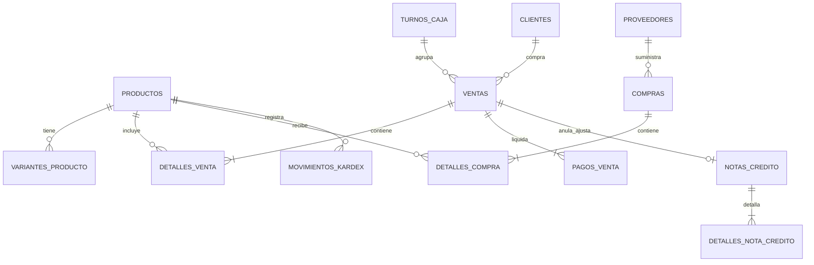

# MANUAL TÉCNICO Y ARQUITECTURA DE SOFTWARE — URBANSTEP
## Sistema de Gestión Fiscal, Financiera (SGF) y Punto de Venta (POS)
### UrbanStep Venezuela C.A. • RIF: J-50123456-7 • Barquisimeto, Estado Lara

---

## 1. VISIÓN GENERAL DE LA ARQUITECTURA

UrbanStep está construido como una aplicación empresarial **Single Page Application (SPA)** de alto rendimiento, diseñada con un enfoque **Offline-First Resiliente** y sincronización reactiva en la nube a través de **Supabase Cloud (PostgreSQL)**.

```
┌────────────────────────────────────────────────────────────────────────┐
│                        CAPA DE PRESENTACIÓN (UI)                       │
│    React 19 • TailwindCSS • Lucide Icons • HTML5 Canvas • Leaflet     │
└───────────────────────────────────┬────────────────────────────────────┘
                                    │
┌───────────────────────────────────▼────────────────────────────────────┐
│                    CAPA DE CONTEXTO Y ESTADO GLOBAL                    │
│   AuthContext • CurrencyContext • CartContext • ShiftContext • Theme   │
└───────────────────────────────────┬────────────────────────────────────┘
                                    │
┌───────────────────────────────────▼────────────────────────────────────┐
│                       CAPA DE SERVICIOS Y LÓGICA                       │
│  saleServices  •  productService  •  returnService  •  auditService    │
│  accountingService (VEN-NIIF)     •  reportService (6 Capas SGF)       │
│  purchaseService • shiftService   •  deliveryService • bcvService      │
└──────────────────┬─────────────────────────────────┬───────────────────┘
                   │                                 │
┌──────────────────▼───────────────┐ ┌───────────────▼───────────────────┐
│     PERSISTENCIA LOCAL / CACHÉ   │ │       PERSISTENCIA EN NUBE        │
│  In-Memory TTL Memoizer • DB.js  │ │   Supabase PostgreSQL • Triggers   │
│  LocalStorage Fallback           │ │   Row-Level Security • Realtime   │
└──────────────────────────────────┘ └───────────────────────────────────┘
```

---

## 2. STACK TECNOLÓGICO Y LIBRERÍAS CLAVE

* **Framework Base:** [React 19](https://react.dev) con Vite como empaquetador ultrarrápido (tiempo de compilación < 1 segundo).
* **Enrutamiento:** [React Router v7](https://reactrouter.com/) con rutas protegidas basadas en roles (`ProtectedRoute.jsx`).
* **Estilos y Diseño:** TailwindCSS con paleta cromática personalizada, soporte bimodal (Dark / Light Mode) y tokens de diseño corporativos.
* **Persistencia Remota:** Supabase Client (`@supabase/supabase-js`) conectado a PostgreSQL 15+.
* **Cartografía e Información Geográfica:** [Leaflet](https://leafletjs.com/) y `react-leaflet` para mapeo de delivery urbano en Barquisimeto.
* **Generación de Documentos y Exportaciones:** `html2canvas` y `jspdf` para comprobantes fiscales PDF, y utilidades nativas CSV/XLSX.
* **Notificaciones y Alertas:** `react-hot-toast` con renderizado contextual accesible.

---

## 3. ESTRUCTURA DEL PROYECTO

```
urbanstep/
├── src/
│   ├── contexts/                  # Proveedores de estado global (Context API)
│   │   ├── AuthContext.jsx        # Sesión, usuario activo y control de roles RBAC
│   │   ├── CurrencyContext.jsx    # Motor bimonetario USD/VES y tasa BCV oficial
│   │   ├── CartContext.jsx        # Carrito POS, variantes por talla/color y descuentos
│   │   ├── ShiftContext.jsx       # Turno de caja activo, arqueo y corte Z
│   │   └── ThemeContext.jsx       # Persistencia de tema (Modo Oscuro / Claro)
│   ├── data/                      # Esquemas de datos iniciales y mocks resilientes
│   │   ├── mockProducts.js        # Catálogo base de calzados
│   │   ├── mockCustomers.js       # Clientes corporativos y público general
│   │   ├── mockUsers.js           # Usuarios del sistema (Admin, Cajero, Supervisor)
│   │   └── mockSales.js           # Historial inicial de ventas
│   ├── layout/                    # Componentes estructurales de navegación
│   │   ├── Layout.jsx             # Contenedor principal con Sidebar y Header
│   │   ├── Navbar.jsx             # Barra de navegación superior
│   │   └── Sidebar.jsx            # Menú lateral dinámico según privilegios
│   ├── pages/                     # Vistas principales de la aplicación
│   │   ├── Dashboard.jsx          # Panel de control ejecutivo y KPIs
│   │   ├── POS.jsx                # Punto de Venta mostrador
│   │   ├── CashierTerminal.jsx    # Terminal exclusivo para cajeros a pantalla completa
│   │   ├── Products.jsx           # Catálogo y disponibilidad por talla/color
│   │   ├── Inventory.jsx          # Control de almacén, valorización y Kardex
│   │   ├── Purchases.jsx          # Compras a distribuidores y retenciones
│   │   ├── Customers.jsx          # Directorio de clientes
│   │   ├── Delivery.jsx           # Monitoreo de envíos y mapa de Barquisimeto
│   │   ├── Reports.jsx            # Suite Contable y Fiscal SGF de 6 Capas
│   │   └── Settings.jsx           # Parámetros fiscales, hardware y usuarios
│   ├── services/                  # Capa de lógica de negocio y persistencia
│   │   ├── accountingService.js   # Motor de Partida Doble VEN-NIIF y Suite Contable
│   │   ├── reportService.js       # Generador de reportes SGF (Capas 1 a 6)
│   │   ├── saleServices.js        # Procesamiento de ventas, stock y facturación
│   │   ├── productService.js      # Catálogo, variantes y protección de eliminación
│   │   ├── returnService.js       # Devoluciones y Notas de Crédito SENIAT (3 motivos)
│   │   ├── purchaseService.js     # Compras, entradas de almacén y crédito fiscal
│   │   ├── shiftService.js        # Arqueos de caja y cortes Z
│   │   ├── deliveryService.js     # Cálculo de rutas y despachos
│   │   ├── auditService.js        # Trazabilidad inmutable de eventos
│   │   ├── bcvService.js          # Sincronización con API del Banco Central
│   │   ├── supabaseClient.js      # Cliente oficial de base de datos
│   │   └── api.js                 # Almacenamiento local DB reactivo
│   ├── ui/                        # Componentes de interfaz reutilizables
│   │   ├── ReturnModal.jsx        # Modal de Devoluciones y emisión de Notas de Crédito
│   │   ├── VariantAvailabilityModal.jsx # Subpantalla de disponibilidad por talla/color
│   │   ├── CustomerSelector.jsx   # Selector y creador rápido de clientes
│   │   ├── Modal.jsx / Button.jsx / Card.jsx / Input.jsx / Badge.jsx
│   │   └── ExportButtonGroup.jsx # Botonera unificada para exportación PDF/Excel
│   └── utils/                     # Utilidades matemáticas, fiscales y de calzado
│       ├── shoeSizes.js           # Normalización de tallas, variantes y disponibilidad
│       └── generateId.js          # Generación de identificadores únicos
```

---

## 4. MODELO DE DATOS RELACIONAL (POSTGRESQL)

El modelo de datos garantiza integridad referencial estricta, trazabilidad contable y cumplimiento fiscal:



### 4.1 Tablas Principales
1. **`productos`**: Catálogo base, marca, SKU, modelo, género, costo base, precio de venta, stock total, stock mínimo, estado (`in_stock`, `low_stock`, `out_of_stock`, `deshabilitado`) y variantes JSONB.
2. **`ventas`**: Comprobantes de venta con numeración fiscal (`numero_recibo`, `numero_control_fiscal`), cliente, cajero, tasa BCV, subtotales, IVA, IGTF, total USD y total Bs.
3. **`detalles_venta`**: Renglones específicos de la venta vinculados a producto, marca, talla, color, cantidad y precios unitarios.
4. **`notas_credito`**: Documentos tributarios bajo Providencia SENIAT 0071 con número correlativo (`NC-2026-XXXX`), factura afectada, motivo legal (`mal_facturado`, `producto_danado`, `factura_fallida`), reembolso y destino de inventario.
5. **`movimientos_kardex`**: Registro histórico inmutable de entradas, salidas, mermas por garantía y devoluciones valorizadas.

---

## 5. MOTOR DE CONTABILIDAD FORMAL SGF (VEN-NIIF)

El servicio [`accountingService.js`](file:///c:/Users/USUARIO/OneDrive/Documentos/urbanstep/urbanstep/src/services/accountingService.js) implementa un motor de **Partida Doble** en tiempo real:

### 5.1 Reglas de Asiento Contable Automático
1. **Venta en Mostrador:**
   * **DEBE:** Cuenta de Cobro según modalidad (`1.1.01.01.002` Caja USD si es divisas, `1.1.01.02.001` Banesco si es Pago Móvil, `1.1.01.02.002` BDV si es Punto de Venta).
   * **HABER:** `4.1.01.01.001` Ventas de Calzado Mostrador POS (Monto neto).
   * **HABER:** `2.1.02.01.001` Débito Fiscal IVA 16%.
   * **HABER:** `2.1.02.02.001` IGTF 3% por Cobrar (si aplica pago en divisas).
   * **Asiento de Costo simultáneo:** DEBE a `5.1.01.01.001` (Costo de Calzado Vendido) vs HABER a `1.1.03.01.001` (Inventario de Calzado).

2. **Nota de Crédito por `mal_facturado` (Error de Facturación):**
   * **DEBE:** `4.1.01.01.001` (Reverso de Ingreso de Venta neto).
   * **DEBE:** `2.1.02.01.001` (Reverso de Débito Fiscal IVA Providencia 0071).
   * **HABER:** Cuenta de Reembolso Caja/Banco.
   * **Reingreso a Inventario:** DEBE a `1.1.03.01.001` (Inventario) vs HABER a `5.1.01.01.001` (Costo de Ventas).

3. **Nota de Crédito por `producto_danado` (Garantía / Falla de Fábrica):**
   * **DEBE:** `4.1.01.01.001` (Reverso de Venta) y `2.1.02.01.001` (Reverso IVA).
   * **HABER:** Cuenta de Reembolso Caja/Banco.
   * **Asiento de Merma:** El costo del calzado defectuoso **NO** regresa a inventario vendible; se asienta como gasto operativo en la cuenta:
     * **DEBE:** `6.1.03.01.001` — *Mermas y Pérdidas de Calzado Dañado / Garantía*.
     * **HABER:** `5.1.01.01.001` — *Costo de Ventas*.

### 5.2 Algoritmo de Alto Rendimiento (`getAccountingSuite`)
Para evitar recálculos recursivos, la función `getAccountingSuite(params)` compila en un **único pase síncrono en memoria**:
1. Obtiene los asientos del Libro Diario.
2. Deriva directamente el Libro Mayor en O(N).
3. Deriva el Balance de Comprobación de sumas y saldos.
4. Genera el Estado de Resultados y el Balance General cuadrado.

---

## 6. OPTIMIZACIÓN DE RENDIMIENTO Y REDUCCIÓN DE LATENCIA

Para solventar cuellos de botella en la renderización de reportes ejecutivos:

1. **Deduplicación de Consultas en Vuelo (In-Flight Promise Sharing):**
   Si 15 funciones solicitan `saleService.getAll()` o `purchaseService.getAll()` al mismo tiempo, las funciones se suscriben a una **única promesa compartida**, evitando 15 consultas simultáneas a Supabase.
2. **Micro-Caché en Memoria (TTL = 4000 ms):**
   Los resultados de las consultas de catálogo y ventas se conservan en memoria durante 4 segundos para absorber ráfagas de lectura de reportes sin degradar la base de datos.
3. **Eliminación de Retardos Artificiales:**
   Se sustituyeron todos los `simulateNetworkDelay` por resolución síncrona inmediata `Promise.resolve()`.
4. **Renderizado No Bloqueante en Reports.jsx:**
   La interfaz se dibuja en menos de 100 ms sin pantallas de espera que bloqueen la navegación del usuario.

---

## 7. SEGURIDAD Y AUDITORÍA INMUTABLE

* **Protección Legal Anti-Borrado:** La función `productService.hasSalesHistory(id)` inspecciona transacciones históricas en base de datos local y remota, denegando físicamente sentencias `DELETE` sobre productos con historial tributario.
* **Trazabilidad en `auditService.js`:** Cada operación (inicio de sesión, cambio de tasa BCV, apertura de turno, cierre Z, emisión de NC, pausa de variantes) genera un registro inmutable con usuario, fecha exacta, módulo e identificador de entidad.
* **Seguridad en Front-End:** Validación tipada y sanitización de entradas numéricas y monetarias evitando desbordamientos o valores negativos.
